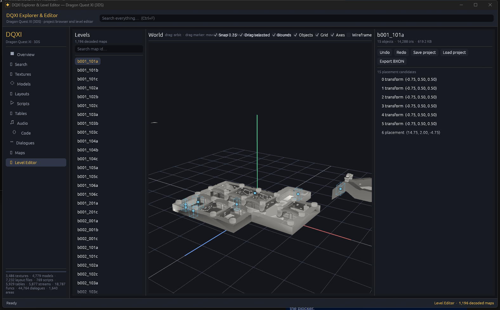
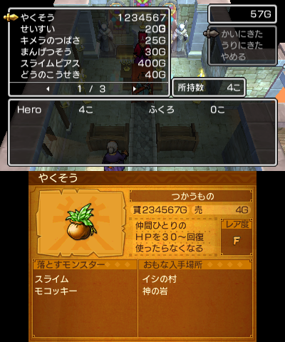
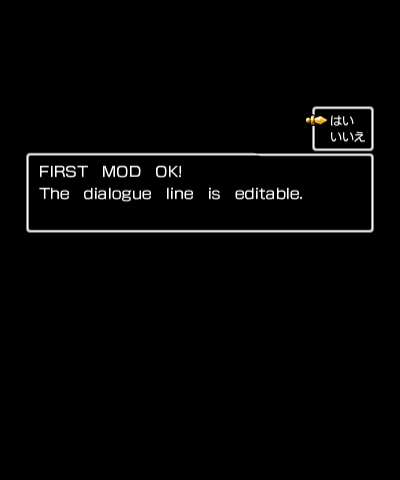
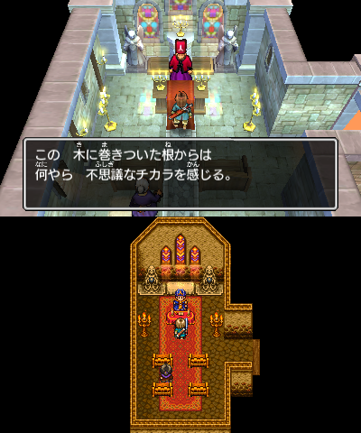
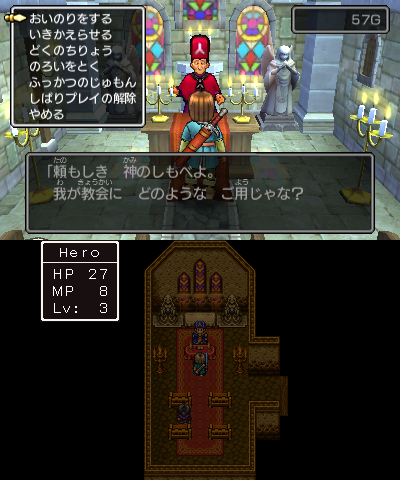
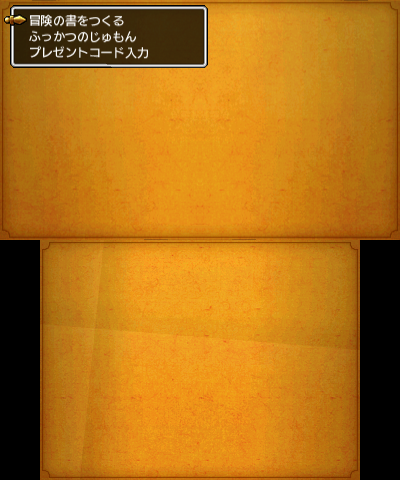

# Dragon Quest XI (3DS) — readable engine, editable data, playable mods

This workspace turns a retail **Dragon Quest XI: Echoes of an Elusive Age** 3DS cartridge
(`CTR-P-BTZJ`, title id `0004000000199200`) into something a person can read, edit and play:

- **Read** the whole native executable as named, summarised C (18,787 entry points, 8,492 named)
  plus a complete ARM/Thumb disassembly that rebuilds the retail `code.bin` byte for byte.
- **Edit** tables, dialogue, scripts, levels, textures, models, audio and UI layouts, and put the
  result back into the game's own file formats.
- **Play** the result in the project's Azahar harness, then export a Luma3DS SD-card folder, a
  rebuilt `.3ds` or an installable `.cia` for real hardware.

The retail ROM and the reference translation checkout are read-only inputs. All generated data
lives in `game_data/`, `game_assets/`, `decomp/`, `build/`, `mod/` and `out/`.

> Reverse-engineering / modding project. You need your own legally obtained copy of the game; no
> game data is redistributed here.

---

## Three ways in

| I want to… | Start here | You need |
|---|---|---|
| **Play with a mod** | **[Your first mod in 10 minutes](docs/FIRST_MOD.md)** — change an item price and a line of dialogue, see them in the emulator, put them on a 3DS | Python only |
| **Edit data in DQXI Studio** | `run_editor.bat` (level editor) or `run_viewer_rs.bat` (browser): Tables, Dialogues, Scripts, Textures, Models, Audio, Layouts, Maps, Playtest | Rust (first build), Python for the tool buttons |
| **Read & change native code** | [Project tour §4](docs/PROJECT_TOUR.md#4-engine-internals--the-guided-tour) then [Native code](docs/CODE.md) and [Source replacement](docs/SOURCE_REPLACEMENT.md) | Python, optionally Ghidra |

`run_editor.bat` and `run_viewer_rs.bat` build the Rust app on first use (a few minutes) and then
open the same 13-section application. All panels call the same command-line tools documented in
[docs/EDITING.md](docs/EDITING.md); nothing is hidden inside the GUI.

> **Command style:** run tools from the repository root as `python -m tools.<tool>` (for example
> `python -m tools.export_mod --target luma`). The equivalent `python tools/<tool>.py` also works;
> the `-m` form is what the guides use because it is unambiguous.

---

## Screenshots

| | |
|---|---|
|  |  |
| **DQXI Studio** — 1,196 decoded maps, placement records as draggable markers, undo/redo, same-size BXON export. | **Table edit in game** — the medicinal herb's `buy_price` changed to 1,234,567 and printed by the shop. |
|  |  |
| **Text edit in game** — one message entry in `ui/title/title_msg` replaced through `tools/text_tool.py` (the `\n` becomes the second line). | **Script edit in game** — a recompiled Squirrel function changes what the priest says. |
|  |  |
| **Native patch in game** — a `code.ips` from `mod/code/code.bin`; live input opens the church menu. | **Retail boot** — an empty mod still reaches the title (the pipeline never invents changes). |

More emulator evidence: [docs/EXPORT.md §8](docs/EXPORT.md#8-verified-in-emulator-2026-10-26) and
`docs/images/emu/`, `docs/images/x3/`, `docs/images/first-mod/`.

---

## What is in here

| Path | What it holds |
|---|---|
| `decomp/readable/` | **The readable native source**: 18,737 `.c` files with name, summary, confidence and evidence in the header |
| `decomp/ghidra/` | Raw Ghidra export and the function catalogue (`functions_merged.jsonl`, `functions_index.json`) |
| `asm/` | Complete modular disassembly; `python -m tools.build` reassembles it into the retail `code.bin` |
| `src/` | Hand-written clean subsystem models and the four bit-verified C replacements |
| `game_data/` | Exact RomFS, every PACK/PACA member and every SARC member (never edited in place) |
| `game_assets/` | Editable conversions: 3,486 textures, 4,779 models, 7,232 layouts, 769 scripts, 5,929 tables, 5,877 audio streams, 1,196 maps, 792 text banks (68,316 strings) |
| `mod/` | **The mod workspace**: `mod/romfs/<exact RomFS path>` plus optional `mod/code/code.bin` |
| `out/` | Export results: `luma/` (SD-card folder), `3ds/`, `cia/`, `EXPORT_REPORT.json`, `emu/` |
| `viewer_rs/` | DQXI Studio (Rust/egui): browser + level editor + playtest panel |
| `tools/` | Every CLI tool, plus `tools/emu/` (Azahar glue) and `tools/ghidra_scripts/` |
| `tests/` | Tier 1–4 end-to-end suite and the opt-in emulator proofs (`tests/emu/`) |
| `progress/` | Generated status pages (see below) |
| `docs/` | Task-oriented guides; start with [the guide index](docs/README.md) |

The full folder-by-folder map, the pipeline diagram and the engine tour are in
[docs/PROJECT_TOUR.md](docs/PROJECT_TOUR.md); every guide is indexed in
[docs/README.md](docs/README.md).

---

## Status

**[Open the progress page](progress/progress.html)** — regenerated by `python -m tools.progress`:
native code per subsystem, coverage map (`progress.svg`), history, asset/editor counts and the
worker board. Raw numbers: `progress/progress.json`.

| Area | Number |
|---|---:|
| Native entry points / decompiled | 18,787 / 18,748 |
| Named native functions | 8,492 (45.2%); `maybe_` = confidence below 0.50 |
| Documented functions | 8,074 |
| Functions compiled from clean C, byte-verified | 4 |
| Tables with named fields | 42 of 5,929 (the gameplay-critical ones) |
| Squirrel scripts decompiled | 769 (8,960 functions); readable source and bit-exact assembly tiers |
| Decoded levels | 1,196 |

The bit-matching build is the safety net: `python -m tools.build` must print
`[PASS] Reconstructed code.bin bit-matches original uncompressed code.bin (0 differences)`.
Generated data is large (the extracted tree is ~10 GB, the retail and rebuilt images are 4 GiB
each); see [docs/REBUILD.md](docs/REBUILD.md) if you need to regenerate it.

---

## Verified commands

Run from the repository root:

```powershell
# bit-matching rebuild of the executable, then the full verification pass
python -m tools.build
python -m tools.verify_project

# end-to-end tests (tiers 1-4) and the editor's unit tests
python tests/run_all.py
cd viewer_rs; cargo test; cd ..

# project-root sanity: what the emulator harness sees
python -m tools.emu info
```

The bit-matching build and the verification pass must stay green; the E2E suite and the Rust unit
tests are the regression net for everything else.

---

## Hardware and limits

- Exports keep the original file formats. RomFS patches rebuild the IVFC hash tree; the `.3ds`
  and `.cia` targets are streamed from the retail image and keep the 4 GiB layout.
- Native code exports are checked for **ARMv6K / VFPv2 only**. An instruction that only exists
  on ARMv7 (what an emulator happily runs) is refused before anything is written. This is what
  keeps a mod working on a real 2DS.
- Most asset write-backs are **same-size** by design (texture payload, model position/index,
  layout panes, audio stream, table scalars, map records). Existing text strings may grow: the PACK
  is re-laid out and a grown PACK is appended to the RomFS with its hash tree rebuilt
  ([REBUILD.md § Files that grow](docs/REBUILD.md#files-that-grow)). Adding rows, panes, meshes or
  bank entries is still not supported.
- The emulator profile is Old 3DS, the stricter memory budget a 2DS must meet. Emulator success
  is necessary, not sufficient: the checklist for a real console is
  [docs/EXPORT.md §10](docs/EXPORT.md#10-real-hardware-checklist-run-on-your-3ds2ds).

---

## Known issues

- The readable C is decompiler output, not a hand-verified port. `maybe_` names and struct field
  offsets are hypotheses; each readable file's header says what the evidence was.
- 4,779 of 10,542 BCH files produce meshes; the rest are backgrounds, rigs or empty resources.
  BXON field names are inferred and schema-backed, not from original headers.
- Only 42 tables have named fields; the other 5,887 are structurally parsed (offset/type) but
  their semantics are unknown.
- No step in this repository has been run on a physical 3DS/2DS. Emulator proofs and the hardware
  checklist are the current evidence.

---

## Reference and credits

`..\3DS_Translate` (read-only) is the proven English translation of the same game.
This project imports its emulator harness (`emutest/`) and its format knowledge instead of
re-inventing them: `dq11tool/` (`.3ds`/CIA building, BLZ, text codec), `_emutest/azahar/`.
The translation workspace's own guides were used for emulator limits, message-window limits and
the ARMv6K rule; it is never modified by this repository.
