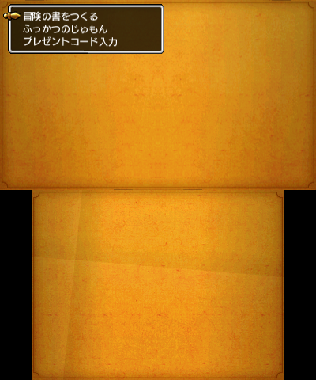
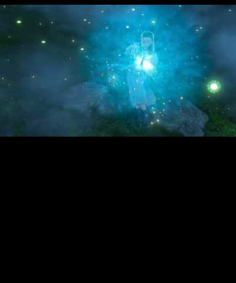
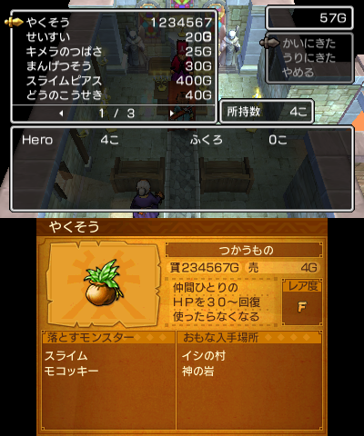
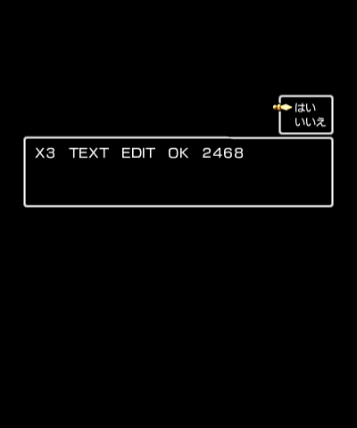
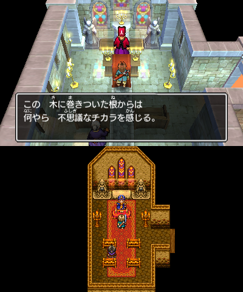
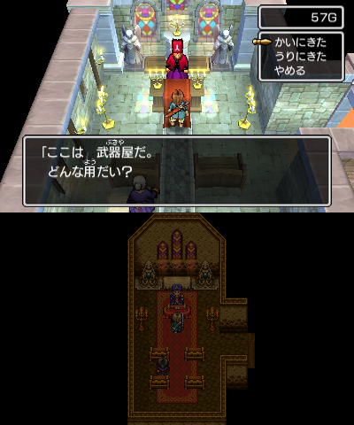
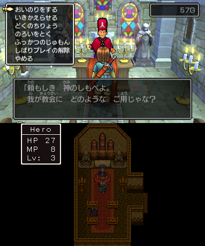

# Exporting a mod for a real 3DS / 2DS

Your edits live in `mod/`. This guide turns that folder into something the console runs, and
explains exactly what was checked before you trust it on hardware.

```powershell
run_export.bat            # asks for a target, writes out/
```

Or call the tool directly:

```powershell
python -m tools.export_mod --target luma     # SD-card folder (recommended)
python -m tools.export_mod --target 3ds      # full 4 GiB cartridge image
python -m tools.export_mod --target cia      # installable CIA (CFW + FBI)
python -m tools.export_mod --target all      # all three
python -m tools.export_mod --target 3ds --no-rom   # only out/3ds/romfs.bin (fast check)
```

Nothing here downloads anything, and nothing in `original/` is modified: every target is built in
`out/` from the retail baseline.

---

## 1. The `mod/` workspace

```
mod/
├── mod.json             name / version / author shown in reports (see mod.example.json)
├── romfs/
│   └── <exact RomFS path>       e.g. mod/romfs/syscmn.pack, mod/romfs/level3d/b001_101a.pack
└── code/
    └── code.bin                 full decompressed native executable (optional)
```

Two rules, both enforced by the exporter:

1. **Full-image targets (`3ds`, `cia`) replace or add; `luma` only replaces.** Luma LayeredFS
   looks files up by path and cannot mount a path the retail RomFS lacks. So `mod/romfs/my.pack`
   is rejected on `luma` — while `--target 3ds`/`cia` rebuild the Level-3 metadata and hash tables
   (`tools/romfs_build.py`) and add the file to the cartridge for real. `mod/romfs/level3d/b001_101a.pack`
   is fine on every target; `mod/romfs/my_own.pack` works on `3ds`/`cia` only. Note that on the
   console an added file matters only together with a native/script change that reads its path.
   Missing parent directories are created too, including a brand-new top-level directory.
2. **The RomFS stores PACK archives, not loose assets.** The item table is a member of
   `syscmn.pack`; the edited table belongs in `mod/romfs/syscmn.pack`, not in
   `mod/romfs/item.bxon`. The `--stage-table` / `--stage-pack` helpers do that repack for you.

A file identical to the retail one is ignored ("unchanged"), so copying a whole pack tree into
`mod/romfs/` is harmless — only differences end up in the output.

An empty `mod/` is a supported, tested state: exporting it reproduces the retail cartridge
byte for byte (SHA-256 `0f04b51b…a9b74`, the same as the retail `DQXI.3ds`). That is the check that
proves the pipeline does not invent changes.

---

## 2. First mod in five minutes (one table value)

`syscmn/item.json` is the item table. Its rows are 88 bytes; `buy_price` sits at row offset 0x18
(`tools/table_schemas.json` records that offset and the evidence for it). Row 0 begins at file
offset 0x2C, so in `item.bxon` the herb's price is the u32 at **0x44**. For named fields the
`table_edit` path in [FIRST_MOD.md](FIRST_MOD.md) is safer; this section shows the raw-offset
route the editor uses underneath.

```powershell
# This tool's help text contains a Unicode arrow; a cp1252 console raises
# UnicodeEncodeError before it can print usage. Set UTF-8 once per terminal.
$env:PYTHONIOENCODING = "utf-8"

# 1. Describe the same-size edit (offset taken from the schema).
$json = @'
{ "source": "game_data/packs/syscmn/item.bxon",
  "edits": [ { "offset": "0x44", "type": "u32", "value": 1234 } ] }
'@
# UTF-8 without a BOM: the tool reads the file with encoding="utf-8".
[IO.File]::WriteAllText("$PWD\build\item_edit.json", $json, [Text.UTF8Encoding]::new($false))
python -m tools.bxon_patch build\item_edit.json --out build\item.bxon

# 2. Rebuild the pack that holds the table, straight into the mod workspace.
python -m tools.export_mod --stage-table syscmn/item.json --replacement build\item.bxon

# 3. Export for the SD card.
python -m tools.export_mod --target luma
```

`--stage-table` reads `pack` from `tools/table_schemas.json` (`syscmn.pack`) and the member
name from the table path (`item.bxon`). For assets whose pack is not in the schema, name both:

```powershell
python -m tools.export_mod --stage-pack ui/common_2d.pack --member item_msg.bxon --replacement build\item_msg.bxon
```

Under the hood both use `tools/patch_asset.py`'s PACK rebuilder, so compressed `PACA` packs are
decompressed, patched and recompressed, and a pack that changes size is handled (`syscmn.pack`
gets *smaller* after a recompress; the RomFS file entry is updated in place).

### Level edits

The level editor's **Export BXON** writes `game_assets/maps/<map>/level3d.patched.bxon`. Stage it
into the mod workspace instead of rebuilding a whole ROM:

```powershell
python -m tools.patch_game --map b001_101a --stage-mod
python -m tools.export_mod --target luma
```

`--stage-mod [DIR]` rebuilds `level3d/<map>.pack`, drops it at `mod/romfs/level3d/<map>.pack` and
stops. Without the flag `patch_game.py` keeps its old behaviour (patch a copy of `romfs.bin` and
repack `build/DQXI_patched.3ds`).

### Native code

```powershell
python -m tools.build                     # asm/ -> build/code.bin (bit-matching check)
python -m tools.build_c_replacement       # src/replacements -> asm/ fragments
copy build\code.bin mod\code\code.bin     # the *decompressed* image, 7,090,176 bytes
python -m tools.export_mod --target luma  # -> code.ips
```

`tools/recompile_game.py` still exists for the "prove the baseline still reassembles" check: it
rebuilds `build/DQXI.3ds` and asserts the retail SHA-256. It is not part of the mod path.

---

## 3. Targets

### `luma` — recommended on real hardware

```
out/luma/titles/0004000000199200/romfs/<only the changed files>
out/luma/titles/0004000000199200/code.ips        (only if mod/code/code.bin differs)
out/luma/titles/0004000000199200/code.bin        (only with --code bin)
out/luma/README.txt
```

Copy the **contents of `out/luma`** to the SD card root so you end up with
`SD:/luma/titles/0004000000199200/…`, then:

1. Power on holding **SELECT** to open the Luma3DS configuration.
2. Enable **"Enable game patching"**, press **START**.
3. Launch Dragon Quest XI.

The title ID is read from the cartridge's own NCCH header (`0x0004000000199200`), not hard-coded.

`code.ips` is a plain IPS diff against `original/exefs/code.decompressed.bin`, so it stays tiny
(one changed byte = 14 bytes). Never keep both `code.bin` and `code.ips` in the title folder —
Luma picks one, and the pair is ambiguous; the exporter refuses to write both.

### `3ds` — a complete cartridge image

```
out/3ds/romfs.bin               the patched, hash-rebuilt RomFS (validated on its own)
out/3ds/DQXI_modded.3ds         full 4,294,967,296-byte NCSD image
```

Written by `tools/repack_rom.py`, which streams the retail NCSD header, card info, NCCH 0
(ExHeader, logo, plain region, ExeFS, RomFS), the manual/update partitions and the 0xFF trailing
padding. For a modified RomFS it recomputes the NCCH RomFS size, content size, RomFS hash-region
size and RomFS superblock hash, the NCSD partition table, and the card-info "filled size", then
moves the following partitions and shrinks the padding so the image stays exactly 4 GiB.

What still does *not* change: the RSA signatures over the NCSD/NCCH headers. They are signed with
Nintendo's private key, so a rebuilt image always fails a signature check. That is fine on CFW
(Luma, Godmode9) and on flashcarts that skip signature checks, and it is why a Linux/CFW tool
such as Godmode9 is the usual way to put the image on an SD card. Use **`luma`** if you simply
want to play a modded game.

Install on a flashcart or CFW SD card:

- Godmode9: copy `DQXI_modded.3ds` to `/gm9/`, open it in Godmode9 → *Gamecart/Image options* →
  mount/install, or write it to a flashcart with a dump tool.
- Or name it `DQXI.3ds` over your own backup on the flashcart; never overwrite the only copy of
  your dump.

The image is *not* trimmed: it keeps the 4 GiB cartridge size and the retail padding, because the
card-info filled size and partition offsets assume it.

### `cia` — install it on a modded console

```
out/cia/DQXI_modded.cia        installable archive (2,685,129,728 bytes for the retail data)
out/cia/README.txt             the same install steps for the person who runs it
```

The CIA is built from the **same validated `out/3ds/DQXI_modded.3ds`** (the `.3ds` is
built first if you asked for `cia` alone, and reused when you ask for `all`). It contains
the game NCCH (content 0) and the electronic manual CFA (content 1). `tools/ctr_cia.py`
is a port of the translation project's proven `dq11tool/ctr/cia.py`; both produce
byte-identical files for the same image.

How the archive is made:

- the **certificate chain and ticket layout** are copied from a system-update CIA that
  ships inside the cartridge's own update partition (partition 6/7 RomFS). They are
  genuine Nintendo certificates; no key or ticket had to be invented.
- the **ticket** is "fakesigned": its RSA signature is blank and its title key is zero,
  because the contents are stored **unencrypted** (this is a decrypted dump). The TMD
  marks content 0 as normal and content 1 as optional/CFA, and carries the SHA-256 of
  both contents, the save-data size from the ExHeader and the SMDH icon from the ExeFS.
- the **TMD** and ticket are therefore consistent with each other and with the bytes in
  the file, but their signatures are not valid for a stock console.

Installing (the translation project ships CIAs built by the same code, used the same way):

1. The console needs **custom firmware with signature patches** — Luma3DS is the usual
   choice. On stock OFW the installer will reject the title ("signature check failed").
2. Copy `DQXI_modded.cia` to the SD card (any folder).
3. Open **FBI** → *Titles* → *Install CIA* (or the SD-file browser in Godmode9 and
   "Install game image"), select the file, confirm.
4. The game appears on the home menu under the retail title ID
   `0004000000199200`. Installing a CIA with the same title ID replaces an installed digital
   copy of that title; the cartridge itself is untouched. The console treats it as the same
   title, so existing SD save data for that title ID is used (a cartridge save lives on the
   game card and is not copied by installing a CIA).

`--no-rom` cannot be combined with `cia`: a CIA must contain the full NCCH contents, not
just `romfs.bin`. The exporter says so before doing any work.

To re-check a file later (e.g. after copying it to an SD card), use the same module directly:

```powershell
python -m tools.ctr_cia verify out/cia/DQXI_modded.cia   # structure + every content hash
python -m tools.ctr_cia info   out/cia/DQXI_modded.cia   # title id, section sizes, contents
```

**What was checked**: the written file is re-parsed by `tools/ctr_cia.py` — header
(0x2020), certificate chain (0xA00, three certificates), ticket (0x350, blank signature,
zero title key, correct title ID), TMD (content-info and chunk-record hashes, both
content SHA-256s) and the file size. In addition, **Azahar (the project's portable
build) installed the CIA through its `-i/--install` option**: the emulated SD card got
`title/00040000/00199200/content/00000000.tmd` byte-identical to the TMD in the CIA,
`00000000.app` (2,683,592,704 B) and `00000001.app` (1,507,328 B) with SHA-256 values
matching the TMD, plus initialised save data. That proves an AM/FBI-style installer
accepts the file; it is not a real-console test (see §9).

---

## 4. Native code changes

`mod/code/code.bin` must be the **decompressed** executable: 7,090,176 bytes, exactly the retail
size, because the ExHeader code-set sizes are not rewritten. That is what `tools/build.py` and
`tools/build_c_replacement.py` produce from `asm/` and `src/replacements/`.

- `luma` diff-compares it against `original/exefs/code.decompressed.bin` and writes `code.ips`
  (or a full `code.bin` with `--code bin`).
- `3ds` BLZ-compresses it, rewrites the ExeFS header and entry hashes, the NCCH ExeFS superblock
  hash, and the image is re-parsed and checked: the decompressed executable inside the output must
  have the SHA-256 of your `mod/code/code.bin`.
- If the recompressed stream no longer fits the retail ExeFS region, `repack_rom.py` stops with a
  clear error instead of writing a cartridge whose RomFS starts in the wrong place. In practice an
  edited `code.bin` keeps the same compressed size (the ExeFS is 0x200-aligned and BLZ lands on the
  same boundary); if it does not, use the `luma` target, which has no layout constraint.

The code path is verified as far as a cartridge image can be without hardware: the image's
containers re-parse, every hash matches, and the executable round-trips through BLZ. It has **not**
been run on a console (see §9).

---

## 5. What the exporter checks before it says OK

Every output is re-parsed by `tools/export_mod.py` itself, not trusted from the writer:

| Check | Where |
|---|---|
| NCSD magic, partition table bounds, no overlap, 4 GiB total | `validate_3ds` |
| NCCH magic, content size vs partition 0, ExHeader SHA-256, logo SHA-256 | `validate_3ds` |
| ExeFS entry hashes + ExeFS superblock SHA-256 | `validate_exefs` |
| `.code` decompresses to 7,090,176 bytes and matches the requested code SHA-256 | `validate_3ds` |
| NCCH RomFS superblock SHA-256 and all three IVFC levels (648,986 data blocks) | `_verify_ivfc` |
| RomFS bytes inside the image are exactly the validated `out/3ds/romfs.bin` | `validate_3ds` |
| Every modified file is present in the rebuilt RomFS with the expected bytes | `RomFsIndex` |
| Empty mod ⇒ image SHA-256 equals the retail hash | `validate_3ds(expect_retail=True)` |
| Luma folder contains exactly the changed files (no extras), bytes round-trip | `build_luma` |
| `code.ips` re-applied to the retail code reproduces `mod/code/code.bin` | `inspect_ips` |
| every changed native instruction is ARMv6K/VFPv2 (no ARMv7/VFPv3) | `tools/check_armv6k.py`, `armv6k` in the report |
| CIA header, certificate chain, ticket/TMD hashes and every content SHA-256 | `ctr_cia.build_cia` → `verify_cia` |

A run that fails any of these exits non-zero and prints which check failed.
`out/EXPORT_REPORT.json` records the title ID, mod metadata, every changed file (size + SHA-256),
the rebuilt image hash and the validation summary.

Beyond the structural checks, the modded image was boot-tested in **Citra Nightly 1917**: the game
loads, runs at 30 fps (100%), and the emulator's own BLZ decompressor maps a `.code` whose memory
matches `original/exefs/code.decompressed.bin` at four sampled offsets (0x0, 0x100000, 0x300000,
0x600000). That is an emulator, not a console — see §9 for what it does and does not prove.

---

## 6. `run_export.bat`

Asks for the target (`luma`, `3ds`, `all`, `cia`, `check`), shows what the mod workspace contains,
runs the exporter and pauses so you can read the result. `check` is `--target 3ds --no-rom`:
it rebuilds and validates `out/3ds/romfs.bin` without writing the 4 GiB image.

---

## 7. Troubleshooting

| Message | Meaning / fix |
|---|---|
| `LayeredFS can only replace RomFS paths …` | The mod adds a file but the `luma` target cannot mount new paths. Use `--target 3ds` or `cia`. |
| `mod/code/code.bin is N bytes; … must keep the retail decompressed size` | Rebuild with `tools/build.py`; do not add or remove sections. |
| `rebuilt ExeFS is N bytes but the retail region is M` | The recompressed code changed the layout. Use `--target luma`. |
| `original/romfs.bin hash … is not the retail baseline` | `original/` was modified; re-run `python -m tools.extract_rom` from your own dump. |
| `--no-rom cannot be combined with the CIA target` | Drop `--no-rom`; a CIA is built from the full `.3ds`. |
| `is not a decrypted image (NCCH flags …)` | The CIA builder stores unencrypted contents; decrypt your dump first (Godmode9). |
| `no system CIA found in the update partition` | The dump was trimmed of partitions 6/7, which hold the certificate chain. Use an untrimmed dump or `--target luma`/`3ds`. |
| FBI: `signature check failed` / title does not start | The console is not running signature patches. Use Luma3DS (or another CFW) and install again. |
| FBI: `CIA is invalid` | The file was truncated in transfer. Re-copy it and compare its SHA-256 with `out/EXPORT_REPORT.json`. |
| `the edited code contains instructions a real 3DS/2DS cannot execute` | `tools/check_armv6k.py` found an ARMv7/VFPv3 instruction in a changed word. Replace it with ARMv6K/VFPv2 code (no movw/movt, ubfx/sbfx/bfi/bfc, sdiv/udiv, mls, rbit, VFP immediates, fixed-point vcvt). |
| Luma boots the unmodded game | "Enable game patching" is off, the folder is at `SD:/luma/titles/<id>/romfs/…`, or the title ID does not match (only one DQXI region/version has `0004000000199200`). |

---

## 7.1 Earlier emulator pass and its findings (first worker run)

> The **final** evidence is §8 (both script tiers show changed behaviour, the table value is
> visible in a shop, both empty targets boot). This subsection keeps the findings of the first
> pass, which still stand: the empty-overlay Azahar crash, the fixed-RPC-port collision, and
> the source-tier script risk.

These runs answer the question the structural checks cannot: *does the edit reach the game and
do what the tool promised?* They use the portable Azahar, the Old-3DS test profile, and a
proven game save that resumes in the Cobblestone church. They are **not** part of the default
test run: `python -m tests.emu` (see `tests/emu/README.md`). The manual evidence is in
`docs/images/x3/`.

| Edit | Tool | What was observed | Evidence |
|---|---|---|---|
| Empty mod, Luma | `export_mod.py --target luma` | 0 changed files; the empty overlay is skipped and the game reaches the title menu (`python -m tests.emu --case boot` → PASS) | `images/x3/empty_luma_title.png`; retail boot at game t=492.3 s (49.5 s real) |
| Empty mod, `.3ds` | `export_mod.py --target 3ds` | the 4,294,967,296-byte image hashes to `0f04b51b…a37a9b74` (exactly retail) and reaches the title menu at game t=439.4 s (49.2 s real) | `images/x3/empty_3ds_title.png` |
| Table | `table_edit.py` + `--stage-table` | herb `buy_price` 8 → 1234567; the exact 88-byte row was read back from guest RAM at `0x31AB4520`, value `1234567` | `docs/images/emu/table_shop_list.png`; `out/emu/x3/table/run/result.json` |
| Text | `text_tool.py` + `save-mod` | the load-game recap prompt shows `X3 TEXT EDIT OK`; the pane text log records `txt1` typing it at game t=521.9–522.2 s | `images/x3/text_edit.png`, `events.jsonl` |
| Script (assembly) | `script_build.py --tier asm` | baseline: talking to the priest shows his greeting and the church menu; edited: the `type == 10/16` comparisons were changed, and the same A press produces **no text and no menu** | `images/x3/script_baseline.png`, `images/x3/script_asm.png` |
| Script (source) | `script_build.py --tier source` | the recompiled `TrgRCommand` runs (talking no longer shows the greeting) but calling `StartUI` directly outside the event context leaves a blank message window; this is a **test marker**, not a shipping edit | `images/x3/script_source.png` |
| Native code | `code.ips` from the test-only HID hook | 173-byte patch re-applies to the exact 7,090,176-byte `code.bin`; the emulator loads that code.bin, `6f2818eb` (`bl 0x724F00`) is in guest RAM at `0x11AD3C`, and live A presses open the save-select screen | `images/x3/native_live_input.png` |
| Real-hardware rule | `tools/check_armv6k.py` | test-hook build: 215 changed words, 0 ARMv7/VFPv3 instructions; a deliberate `vmov.f32 s0, #1.0` is reported and **`export_mod.py` exits 2 without writing `out/luma`** | `tests/emu/test_check_armv6k.py` (5/5) |

**How the native proof is chained.** Azahar cannot load a Luma `code.ips`; it wants a
decompressed `exefs/code.bin`. The exporter was therefore run twice from the same workspace:
once with the default `--code ips` (the real release format) and once with `--code bin` (the
emulator format). `tools/export_mod.apply_ips(retail, code.ips) == code.bin` is checked byte
for byte before the emulator boots the code.bin. That is the same chain Luma performs on
hardware; only Azahar's file format differs.

**What the table proof means.** The game does not read `mod/`; it reads the rebuilt
`syscmn.pack` through LayeredFS. Finding the exact patched row (including the new `0x12D687`
price) in `.data` after the save loads proves the pack, the RomFS offset and the BXON writer all
worked, not merely that the JSON said so.

**A real finding: an empty LayeredFS overlay crashes Azahar.** The first empty-mod boot
produced `unmapped WriteBlock @ 0x0C1A8000` at PC `0x0051924C`. An overlay with no files has
nothing to mount, and Azahar's LayeredFS mis-handles it; `tools/emu/extras.py:install_mod` now
skips empty overlays. The export itself is still correct: it contains zero changed files, and
the `.3ds` target is byte-identical to retail.

**A real finding: the source-tier script compiler is not safe for arbitrary edits yet.** Adding
a new function or starting an event from `OnBeginScene` produced a `b011.pack` that crashed the
game at/near boot. Recompiling only `TrgRCommand` is stable, but a direct `StartUI` call leaves
a blank window. The **assembly tier** is byte-exact and behaved correctly. Do not ship a
source-tier script edit without boot-testing it; see the follow-up list in
`orchestration/done/X3_boot_tests.md`.

**Concurrent-emulator caveat.** Azahar's RPC port (`45987`) is fixed in the emulator; two
instances cannot run at once. When another worker was using it, launches failed with a reset
connection. `tests/emu` now refuses to start and says so (`netstat` check). Run the suite when
no other Azahar is active, or point `DQ11_EMUTEST` at a separate data root **and** wait for the
other instance to exit.

---

## 8. Verified in emulator (2026-10-26)

Every edit below was made with this project's tools, exported with `tools/export_mod.py`, and
then **played** in the project's portable Azahar (`third_party/emutest/`, an Old-3DS memory
profile, the data root set up by `tools/emu/`). The mods are LayeredFS folders; the game save
is `user_citra` (Cobblestone church, Hero Lv 3). The test-only input hook and pane-text logger
are applied to the emulator run's executable only — they are not part of any export.

```powershell
python tests/emu/run_cases.py           # the run quoted below (about 10 minutes)
python -m tests.emu --case boot         # the first pass's boot-only runner (isolated root)
python -m unittest tests.emu.test_armv6k -v
python -m unittest tests.emu.test_check_armv6k -v
```

Result: the runner exposes **eight** cases (`python tests/emu/run_cases.py --list`); the per-case
evidence from the last full pass is under `out/emu/x3/<case>/` and the screenshots are below.
`out/emu/x3/summary.json` is rewritten by every run (including a single-case run), so use the
per-case directories when you need the durable record. Each case's full
evidence — export report, event log, screenshots, the exact edit — is under
`out/emu/x3/<case>/`; the runner copies the images used here to `docs/images/emu/`.

| # | Edit | What the game did | Evidence |
|---|---|---|---|
| 1 | **Empty mod**, Luma folder | title screen, exit 0 |  |
| 1 | **Empty mod**, rebuilt 4 GiB `.3ds` (retail-identical) | title screen, exit 0 |  |
| 1 | Empty mod + game save, **input movie** (no test hook) | title → Continue → save: the story-recap question |  |
| 2 | **Table**: `syscmn/item.json` herb `buy_price` 8 → 1234567, shop record 68 copied over all, first goods slot = herb row | shop goods list prints **やくそう 1234567G** |  |
| 3 | **Text**: `ui/title/title_msg` entry 22 replaced with `X3 TEXT EDIT OK 2468` | the message window shows the marker (also found in the live UI heap at `0x33…`) |  |
| 4 | **Script, source tier**: `script/b011` `TrgRCommand` starts `IE_Z_M01_TAIJU` on talk | talking to the priest shows the book message instead of the church menu |  |
| 4 | **Script, assembly tier**: `TrgRCommand` starts `common.ShopEvent` (two literals + eight instructions in the annotated listing) | talking opens the shop |  |
| 5 | **Native code via `code.ips`**: the input hook, exported as an IPS and applied to the retail executable exactly as Luma does | live RPC press opens the church menu; the hook's read counter advances |  |

### What each result proves

- **Empty mod / rebuild.** Both targets boot to the title menu (the detector requires the
  Japanese title-menu strings in the live UI pane buffers, not merely in the resource cache).
  The rebuilt image is validated as retail-identical (`retail_identical: true`), so the
  export path invents no changes.
- **Table.** The shop list is drawn from the item table the game loaded. The first row is the
  medicinal herb at the edited price; `shop.bxon`'s values are **item row indices** (row 0 =
  herb), not the `id` field — confirmed in-game and worth remembering when editing shops.
- **Text.** The string reaches a message window; the marker is also in the live UI heap
  (`find_utf16` at `0x33000000–0x34000000`) at the moment of the screenshot.
- **Scripts.** Both build tiers change behaviour: the readable source compiles to a CNUT whose
  `TrgRCommand` starts the book event, and the annotated listing assembles to one that starts
  the game's own `common.ShopEvent`. The two outputs behave differently from each other and
  from retail.
- **Native code.** `code.ips` (897 bytes for the hook + pane logger) applies to the retail executable and
  reproduces the test build byte-for-byte; booted through LayeredFS the game accepts the RPC
  presses. On an empty/unmodified executable those presses do nothing (`hook_alive: false`).
- **Hardware gate.** `tools/check_armv6k.py` rejects VFPv3 `vmov`, `movw/movt`, `sdiv/udiv`,
  `ubfx/sbfx`, `bfi/bfc`, `rbit` in changed words, skips PC-relative literal pools, and
  `tools/export_mod.py` stops with exit 2 before writing anything. Eight unit tests cover it,
  including a deliberately broken mod that must not produce output.

Two practical notes from the runs (also in `tests/emu/README.md`):

- The pane-text logger's ring sits at the end of the UI heap. On this emulator profile that
  address is sometimes outside the writable linear heap; the tests detect this and fall back to
  screenshots plus a live-RAM scan, so a dead logger cannot masquerade as "the edit did
  nothing".
- Azahar occasionally exits ~40 s into a run on this host (NVIDIA driver, also with the
  unmodified ROM). The runner retries; every failure was an emulator exit, never a guest fault
  in the edited data.

---

## 9. What is **not** verified

- **No real console.** No 3DS/2DS was available, so "it runs on hardware" is not proven. What *is*
  proven is that the containers, sizes and every hash the console checks re-parse and match, that
  an empty mod is byte-identical to retail, and that the rebuilt image boots in an emulator:
  Citra Nightly 1917 loads `out/3ds/DQXI_modded.3ds`, reports the game at **30 fps (100%)**, the
  emulator's own BLZ decompressor maps a `.code` whose memory matches the retail executable at
  every sampled offset, and video memory updates continuously. (Azahar 2126.2 stalls at boot with
  *both* the retail and the modded image because its fresh user dir has no save data — an
  environment issue, not an export issue.) The title screen, the save-load prompt and the
  in-game edits were later captured in Azahar; see §8.
- **The edited data itself was exercised in the emulator** (see §8): the patched item value
  is printed by a shop, the replaced recap line is in a message window, and both script tiers
  change behaviour. What is still missing is a **console**: the same screens on real hardware.
- **The native test hook is not a shipping edit.** It is exported only into
  `out/emu/tests/native/`; it proves that a real native change executes and that the IPS format
  round-trips. A real `code.ips` for release still has to pass the same ARMv6K check and a
  console boot (the test hook itself is ARMv6K-clean, 39 changed words, 0 violations).
- **The source-tier script compiler can produce a pack that crashes the game** (a new function
  or an event started from `OnBeginScene`). Assembly-tier scripts are byte-exact and tested;
  source-tier edits need their own boot test before shipping. See `X3_boot_tests.md`.
- **RSA signatures are stale** in the rebuilt `.3ds` (impossible to fix without Nintendo's key).
  CFW/flashcarts that enforce signatures will reject it; Luma LayeredFS avoids the question.
- **Added RomFS files are hashed but unproven on the console.** The `3ds`/`cia` exporters now
  rebuild the Level-3 metadata and hash tables to mount new paths: the 21,250 retail files come
  back byte-identical, the emulator parses the added entries (Azahar uses the same RomFS layout),
  and a mod with an added file exports with `--no-rom` and full-image validation green. No real
  console has ever booted an image with an added file; LayeredFS (`luma`) still refuses them.
- **The CIA is fakesigned**, so it only installs on CFW with signature patches. Its content is
  unencrypted with a zero ticket key, which is valid for an installed title (the TMD says so) but
  is not what Nintendo's eShop would serve. **No real 3DS install was possible**: the evidence is
  a full re-parse plus Azahar's own AM installer writing both contents to its emulated SD card.
  Whether a particular FBI/Luma version accepts it on hardware is very likely (the translation
  project ships CIAs built the same way) but not proven here.
- **CIA export costs one extra 4 GiB `.3ds` build plus a 2.7 GB write.** `--target all` reuses the
  image; `--target cia` alone builds it first. Budget ~60 s and ~7 GB of free disk.
- The `code.ips` format is the plain IPS Luma expects; RLE records are never emitted, so a very
  large diff produces a bigger patch, not a broken one.

---

## 10. Real-hardware checklist (run on your 3DS/2DS)

The emulator proves the edits execute; it cannot prove the console accepts them. Do this short
pass on the target hardware before sharing a mod:

- [ ] **Luma is actually patching.** Boot holding SELECT, enable *Enable game patching*, then
      launch the game. The title menu must show your change; if not, check
      `SD:/luma/titles/0004000000199200/` (only the changed files, no `code.bin` **and**
      `code.ips` together).
- [ ] **Empty mod control.** Export an empty `mod/`, install it, and confirm the game still
      reaches the title and loads a save. This catches a bad SD layout before blaming an edit.
- [ ] **Table.** With the herb-price test edit, buy or inspect the herb and see `1234567`; the
      emulator proof is a RAM read, a shop screen is the on-console equivalent.
- [ ] **Text.** Load a save and confirm `X3 TEXT EDIT OK` (or your line) appears in the recap
      window. Check the line does not clip: the dialogue buffer is 255 UTF-16 units and the box
      is 321 px / 3 lines.
- [ ] **Script (assembly).** Talk to the Cobblestone priest; with the test edit he no longer
      greets you. With your own edit, confirm the intended new behaviour and that it does not
      soft-lock the scene.
- [ ] **Script (source).** Do not install a source-tier edit until it has booted in the
      emulator; the compiler is not byte-exact and a new function has crashed a build.
- [ ] **Native code.** Only install a `code.ips` you built yourself. It must pass
      `python -m tools.check_armv6k` (exit 0). If the console shows "undefined instruction",
      remove the patch and report the address from `tools/check_armv6k.py` output.
- [ ] **Memory budget.** Test the Old 3DS / 2DS profile in 2D, 3D and 2way, and open the item
      and shop menus; the UI heap is the tightest on Old 3DS. Emulator tests here use the
      Old-3DS profile on purpose.
- [ ] **Save compatibility.** Keep a backup of your save. The test save is the translation
      project's early Cobblestone save; your own save is the real check.
- [ ] **Remove test artifacts.** `build/emu_test/`, `out/emu/tests/` and the test hook
      `build/emu_test/code_*.bin` must never be copied to the SD card. A release export contains
      only `out/luma/...` (or the `.3ds`/`.cia`) built from `mod/`.

